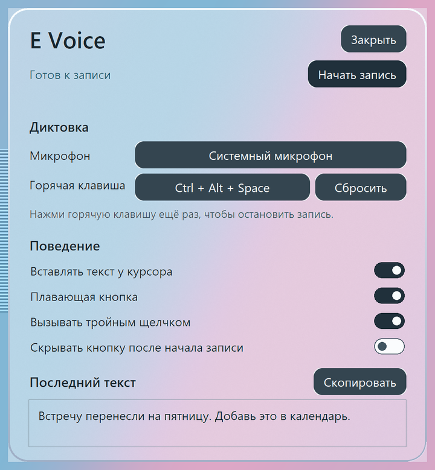

# E Voice

**Голосовой ввод на русском для Windows, macOS и Linux.** Поставьте курсор в поле ввода, нажмите плавающий микрофон, произнесите фразу и нажмите ещё раз. E Voice вставит текст и добавит пробел для следующей фразы. В сеансе Wayland результат можно вставить через буфер обмена.

Распознавание работает на процессоре компьютера. Русская модель и всё необходимое для её запуска уже в пакете. После скачивания можно установить E Voice и диктовать без интернета, аккаунта и подписки.

## Скачать

Выберите пакет **E Voice 1.1.1** для своего компьютера. Его можно скачать без входа в GitHub и перенести на флешке.

| Система | Скачать с моделью |
| --- | --- |
| Windows 10/11 x64, Windows 11 ARM с эмуляцией x64 | [Установщик EXE · 183 МБ](https://github.com/moldset-mmc/e-voice/releases/download/v1.1.1/E-Voice-Setup-x64.exe) |
| Mac с Apple Silicon (M1 и новее) | [Установщик PKG · 199 МБ](https://github.com/moldset-mmc/e-voice/releases/download/v1.1.1/E-Voice-macOS-arm64.pkg) |
| Mac с Intel | [Установщик PKG · 201 МБ](https://github.com/moldset-mmc/e-voice/releases/download/v1.1.1/E-Voice-macOS-x86_64.pkg) |
| Linux x86-64 | [Пакет DEB · 203 МБ](https://github.com/moldset-mmc/e-voice/releases/download/v1.1.1/E-Voice-Linux-amd64.deb) · [Архив · 221 МБ](https://github.com/moldset-mmc/e-voice/releases/download/v1.1.1/E-Voice-Linux-amd64.tar.gz) |
| Linux ARM64 | [Пакет DEB · 201 МБ](https://github.com/moldset-mmc/e-voice/releases/download/v1.1.1/E-Voice-Linux-arm64.deb) · [Архив · 222 МБ](https://github.com/moldset-mmc/e-voice/releases/download/v1.1.1/E-Voice-Linux-arm64.tar.gz) |

**Первый запуск.** Откройте установщик и разрешите доступ к микрофону, если система попросит. E Voice появится в меню «Пуск» на Windows, в `~/Applications` на Mac или в меню приложений Linux после установки DEB. Откройте любой редактор и попробуйте продиктовать одну фразу.

Пакеты выпуска распространяются без коммерческой подписи. На Mac для открытия PKG может потребоваться подтверждение в **Системные настройки → Конфиденциальность и безопасность**. [Инструкция Apple](https://support.apple.com/102445) · [Все файлы выпуска и контрольные суммы](https://github.com/moldset-mmc/e-voice/releases/tag/v1.1.1)

### Установка одной командой

**Windows 10/11.** Выполните в командной строке (`cmd.exe`) из папки для загрузки. При обновлении сначала закройте E Voice через его меню в области уведомлений.

```bat
curl.exe -fL https://github.com/moldset-mmc/e-voice/releases/download/v1.1.1/E-Voice-Setup-x64.exe -o E-Voice-Setup-x64.exe && E-Voice-Setup-x64.exe /SILENT
```

**macOS и настольный Linux.** Выполните в терминале. Скрипт выберет пакет для вашего процессора, проверит SHA-256 и установит E Voice для текущего пользователя.

```sh
curl -fsSL https://raw.githubusercontent.com/moldset-mmc/e-voice/v1.1.1/installer/install.sh -o install-e-voice.sh && sh install-e-voice.sh
```

Для установки скриптом **без сети** положите пакет и `SHA256SUMS.txt` в одну папку. На Linux скрипту нужен архив `.tar.gz`. Из копии репозитория запустите `./installer/install.ps1 -FromDirectory <папка>` в PowerShell или `sh installer/install.sh --from <папка>` на Mac и Linux. [Скачать SHA256SUMS.txt](https://github.com/moldset-mmc/e-voice/releases/download/v1.1.1/SHA256SUMS.txt) · [Исходники установщиков](installer)

## Управление

| Что нужно сделать | Как это работает |
| --- | --- |
| Начать или закончить диктовку | Нажмите микрофон или `Ctrl + Alt + Space`. Во время записи на том же месте появится кнопка остановки. |
| Назначить свою клавишу | Нажмите **⋯ → Горячая клавиша** и задайте клавишу или сочетание. `Esc` отменяет выбор. |
| Открыть меню или подвинуть микрофон | Нажмите маленькую кнопку **⋯** слева от микрофона. Для перемещения зажмите сам микрофон и перетащите его. |
| Скрыть или вернуть кнопку | В меню выберите **Свернуть кнопку** (на Mac и Linux — **Скрыть кнопку**). Три быстрых левых щелчка вызывают её около указателя, слева, если хватает места. Повторный запуск E Voice тоже возвращает кнопку. В Windows доступен значок на панели задач. |
| Сменить микрофон или скопировать последнюю фразу | Откройте **⋯ → Настройки**. В разделе с результатом нажмите **Скопировать**. |

<details>
<summary>Посмотреть окно настроек в Windows</summary>



</details>

**Вставка текста.** В Windows E Voice вводит текст напрямую. Если после остановки записи вы перейдёте в другое окно до окончания распознавания, готовая фраза останется в настройках. На Mac и в X11 для вставки используется системный буфер. На Mac разрешите E Voice универсальный доступ и мониторинг ввода для работы глобальной клавиши.

**В Wayland** запускайте запись с плавающего микрофона. После остановки вставьте текст через `Ctrl+V` или сочетание вашего редактора. Для отображения кнопки нужен XWayland. Глобальная клавиша и тройной щелчок в Linux доступны в сеансе X11.

## Совместимость и ресурсы

Выпуск проверен на Windows x64, Windows 11 ARM с эмуляцией, macOS 15 на Apple Silicon и Intel, Ubuntu 22.04 на x86-64 и ARM64. Для Linux нужны glibc 2.35 или новее и графическая сессия. Поддержка мобильных и 32-битных систем в этот выпуск не входит. [Испытания установленных пакетов](AUDIT.md#испытания-установленных-пакетов)

**Сколько ждать после диктовки?** Запись начинается сразу. E Voice загружает модель с диска параллельно с первой фразой, повторно использует её для следующих и освобождает через 30 секунд простоя. Новое скачивание не требуется.

| Измерение на Windows x64 | E Voice 1.1.1 |
| --- | --- |
| Установка из заранее скачанного пакета с проверкой SHA-256 | около 18 с |
| От остановки до текста, модель уже в памяти | 173 мс |
| От остановки до текста, модель загружается заново | 964 мс |
| Память до первой записи → с моделью → после выгрузки | 52,5 → 362,5 → 59,9 МиБ |

Задержки — медианы трёх повторов на виртуальной машине GitHub. На вход подавали одну секунду тестовой речи. Загрузка могла начаться за секунду до остановки. При немедленной остановке после холодного старта один прогон занял 1,99 с. На другом процессоре или диске время будет отличаться. [Условия измерений и результаты](AUDIT.md#скорость-оперативная-память-и-размер)

**Приватность.** При обычной диктовке E Voice держит запись и последнюю фразу в оперативной памяти. На диск записываются настройки управления и микрофона. Если результат попал в системный буфер, срок его хранения зависит также от менеджера буфера.

## Код и модель

Приложение написано на **Python 3.14**. Tk и системные API управляют плавающей кнопкой, клавишами и вставкой текста. PortAudio захватывает звук. Распознавание выполняют нативные библиотеки **sherpa-onnx и ONNX Runtime** в отдельном процессе. [Распознаватель](speech_engine.py) · [Управление процессом и моделью](recognition_session.py) · [Оценка переноса на Rust](AUDIT.md#оценка-переноса-на-rust)

В комплекте **GigaAM v3 E2E RNNT** для русской речи (`ru`). Для английского (`en`), румынского (`ro`) или украинского (`uk`) нужна модель, обученная для соответствующего языка. Авторский код E Voice и модель распространяются по MIT. [Лицензия E Voice](LICENSE) · [Лицензия модели](models/gigaam-v3/LICENSE) · [Авторы и сторонние компоненты](THIRD_PARTY.md)

## Сборка и проверка

Для разработки используйте 64-битный CPython 3.14 с Tcl/Tk и виртуальное окружение. Сборка установщика Windows требует Inno Setup, macOS — `pkgbuild` и `productbuild`, Linux — PortAudio, Tcl/Tk и `dpkg-deb`. Выполните команды в корне проекта. [Сборка на чистых системах](.github/workflows/desktop.yml)

```sh
python -m pip install -r requirements.lock.txt
python -m unittest discover -s tests
python build_release.py
```

Сборщик загружает файлы модели из закреплённой ревизии и проверяет их по SHA-256. Для сборки без сети положите файлы в `models/gigaam-v3` и передайте `--offline`. Для Windows путь к Inno Setup можно указать через `--iscc`. Пакеты появятся в `dist`. [Манифест модели](models/gigaam-v3/manifest.json)

В установленной версии папка `models` находится рядом с EXE в Windows, внутри `_internal` на Linux и в `Contents/Resources` на Mac. Проверить распознавание без микрофона и графического интерфейса можно на тестовом моно WAV PCM16. Результат сохранится в JSON в UTF-8.

```sh
python app.py --transcribe tests/fixtures/russian-example.wav --output result.json
```
